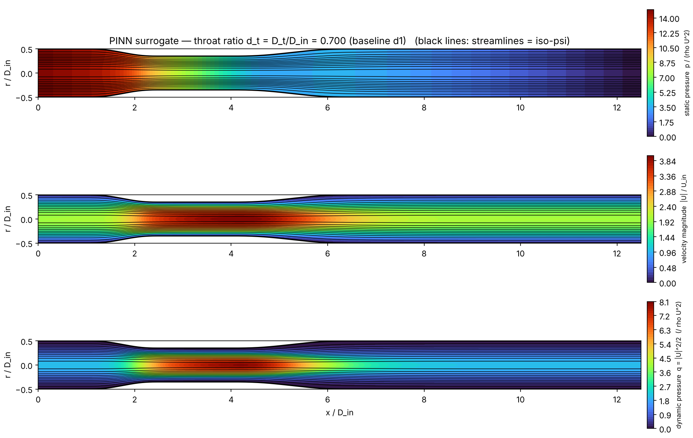
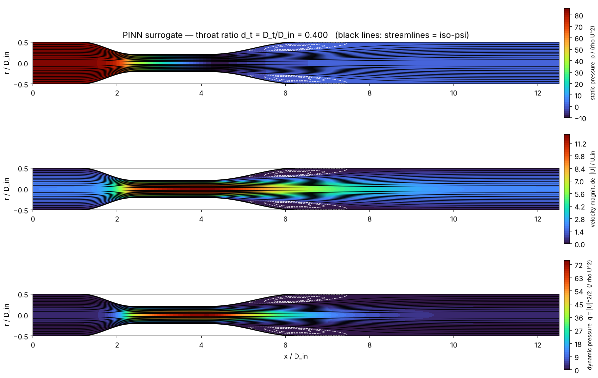
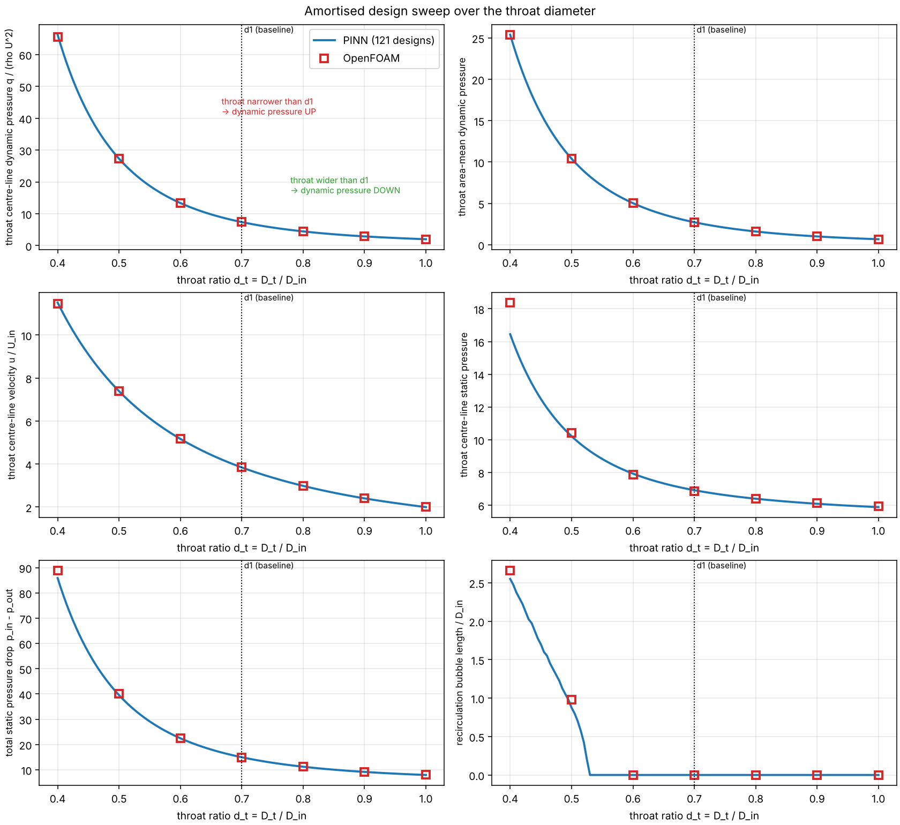
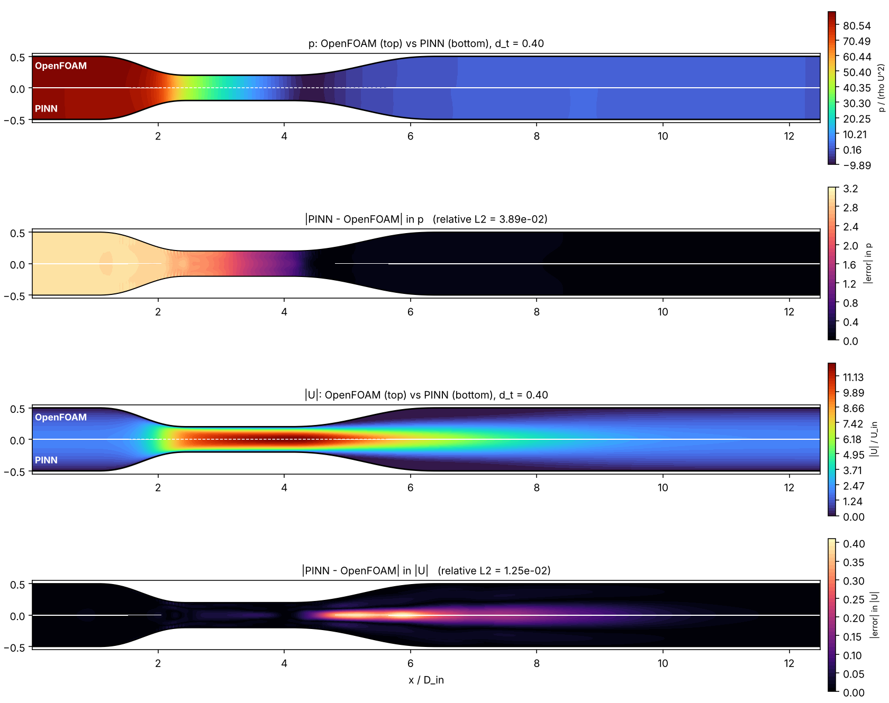
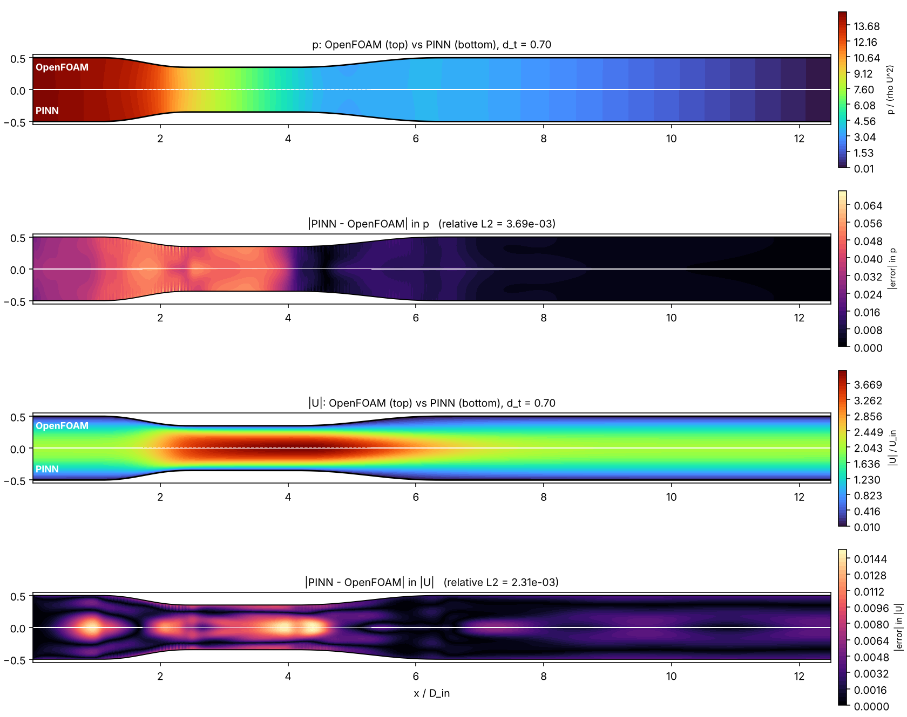
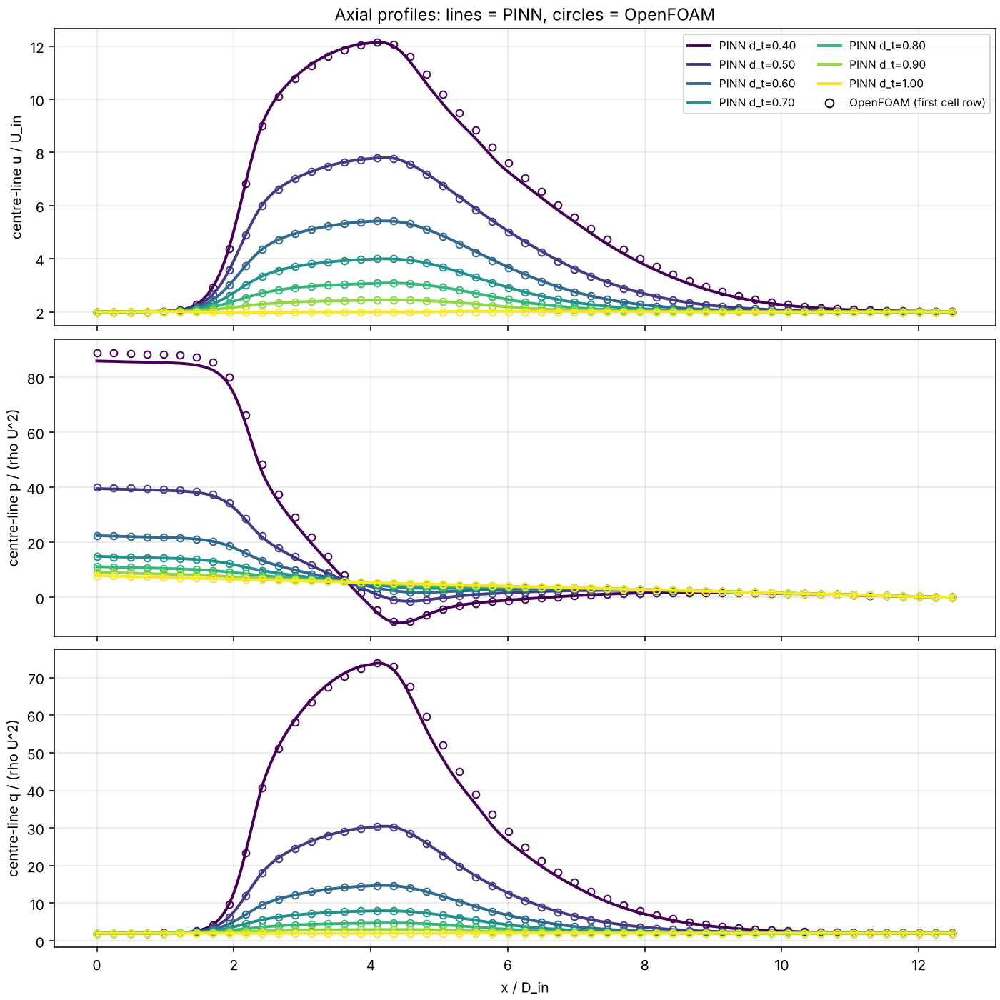
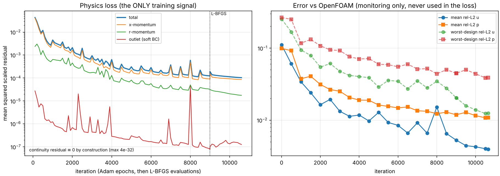
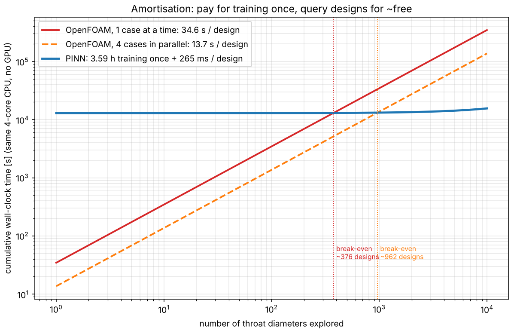

# PINNs-Bernoulli — a parametric PINN solver for a converging–diverging nozzle

**A Physics-Informed Neural Network (PINN) that solves the Navier–Stokes
equations for water flowing through a converging–diverging nozzle, for every
throat diameter at once, with no CFD training data. It is benchmarked
against OpenFOAM on the identical problem.**

```
          inlet      converging        throat         diverging (diffuser)       outlet
        ________                                                    ____________________
                \____                                         _____/
  flow  =====>       \_______________________________________/              =====>
                      <------- D_t : the design parameter ------->
        ________ ____/                                        \_____ ____________________
                                                                    \
```

The throat diameter `D_t` is an **input to the network**. One training run
produces a solver for every nozzle with `d_t = D_t/D_in` between 0.40 and
1.00, including the baseline `d1` (`d_t = 0.70`) and every wider and narrower
throat. After training, a new geometry costs one forward pass of the network
(0.26 s for a full 30k-point flow field) instead of a new CFD run. That is
**amortisation**: the expensive part is paid once, every further design is
almost free.

## Results at a glance

| | |
|---|---|
| Accuracy vs OpenFOAM, physics-only training | **0.40 % (velocity) / 1.1 % (pressure)** mean relative L2 error over d_t = 0.4–1.0; worst case 1.3 % / 3.9 % at the narrowest, separated nozzle |
| What happens to the dynamic pressure | Throat dynamic pressure rises **9×** when the throat closes from d1 to 0.4 and falls to **0.27×** when it opens to 1.0, exactly as expected from continuity + Bernoulli, plus viscous losses and separation that only Navier–Stokes captures |
| Cost, same 4-core CPU, no GPU | training 3.6 h once, then **0.26 s per design**; OpenFOAM **34.6 s per design** (13.7 s with 4 cases in parallel) |
| Amortisation | break-even at ~376 designs (vs serial OpenFOAM) or ~962 (vs 4-parallel); at 10,000 designs the PINN is 22× / 8.8× cheaper |

Full details: [§14 Results](#14-results). All 7 unit tests pass (`pytest tests -q`).

---

## How to read this codebase, in order

This README teaches the theory and then walks through **every piece of the
code**, quoting the real source and explaining each line. The source files
carry the same explanations in their docstrings. Read them in this order;
each depends only on the ones above it:

| # | File | You will understand |
|---|---|---|
| 1 | [`configs/nozzle.yaml`](configs/nozzle.yaml) | Every number in the project, in one place |
| 2 | [`nozzle_pinn/geometry.py`](nozzle_pinn/geometry.py) | The nozzle wall as a smooth, differentiable formula |
| 3 | [`nozzle_pinn/model.py`](nozzle_pinn/model.py) | The network, the stream function and the hard boundary conditions, i.e. how the network's output is turned into a flow that *cannot* violate mass conservation or the boundary conditions |
| 4 | [`nozzle_pinn/physics.py`](nozzle_pinn/physics.py) | **The core trick**: the Navier–Stokes equations evaluated on the network with `torch.autograd.grad` |
| 5 | [`nozzle_pinn/sampling.py`](nozzle_pinn/sampling.py) | Where the physics is checked, across thousands of nozzles at once, and adaptive refinement |
| 6 | [`nozzle_pinn/train.py`](nozzle_pinn/train.py) | The loss function and the training loop (Adam, then L-BFGS) |
| 7 | [`nozzle_pinn/inference.py`](nozzle_pinn/inference.py) | Querying the trained solver for any throat diameter: the amortised part |
| 8 | [`nozzle_pinn/openfoam.py`](nozzle_pinn/openfoam.py) | Writing, running and reading the OpenFOAM reference cases |
| 9 | [`nozzle_pinn/compare.py`](nozzle_pinn/compare.py), [`nozzle_pinn/postprocess.py`](nozzle_pinn/postprocess.py) | Grading the PINN against OpenFOAM; contours, streamlines, animation, ParaView |
| 10 | [`scripts/`](scripts/) | The three commands that run everything |

---

## Contents

1. [Why this project exists](#1-why-this-project-exists)
2. [When a PINN surrogate beats a CFD solver (and when it does not)](#2-when-a-pinn-surrogate-beats-a-cfd-solver-and-when-it-does-not)
3. [The physics: governing equations, derived](#3-the-physics-governing-equations-derived)
4. [PINN theory from absolute zero](#4-pinn-theory-from-absolute-zero)
5. [The stream function: making mass conservation impossible to break](#5-the-stream-function-making-mass-conservation-impossible-to-break)
6. [Hard constraints: the full ansatz, snippet by snippet](#6-hard-constraints-the-full-ansatz-snippet-by-snippet)
7. [How the equations become the loss function](#7-how-the-equations-become-the-loss-function)
8. [Network architecture (and why)](#8-network-architecture-and-why)
9. [Where the physics is checked: collocation sampling](#9-where-the-physics-is-checked-collocation-sampling)
10. [The training loop](#10-the-training-loop)
11. [Inference: the amortised part](#11-inference-the-amortised-part)
12. [The OpenFOAM reference solver](#12-the-openfoam-reference-solver)
13. [Comparison and post-processing](#13-comparison-and-post-processing)
14. [Results](#14-results)
15. [How to run everything](#15-how-to-run-everything)
16. [Tests: what each one proves](#16-tests-what-each-one-proves)
17. [Repository layout](#17-repository-layout)
18. [Limitations and next steps](#18-limitations-and-next-steps)
19. [References](#19-references)

---

## 1. Why this project exists

Designing a nozzle (or a venturi meter, an injector, a pipe contraction)
means asking the same question many times: *what does the flow look like if
I change the throat?* A CFD solver answers it one geometry at a time. Each
answer needs a new mesh and a new solve, and nothing learned from one design
is reused for the next.

A **parametric PINN** turns this around. The geometry parameter (here the
throat diameter) becomes an *input* of a neural network, and the network is
trained, using only the governing equations, to be the solution for **every**
value of that parameter at once. After that, "what if the throat were 6.37 mm?"
is answered by evaluating a function. No mesh, no solver, no iterations.

This repository builds that solver completely, from the equations up:

- the **governing equations** and why they are the right ones (§3);
- what a neural network is, and how automatic differentiation lets it be
  checked against a differential equation (§4);
- how the network's output is *constructed* so mass conservation and every
  boundary condition hold exactly (§5–§6);
- how the remaining equations become a loss function (§7);
- training, inference, an OpenFOAM reference, and the honest comparison
  (§8–§14).

## 2. When a PINN surrogate beats a CFD solver (and when it does not)

| | CFD solver (OpenFOAM) | Parametric PINN (this repo) |
|---|---|---|
| Training data needed | — | **none**: the equations are the training signal |
| Cost of the first design | seconds to hours | hours (training) |
| Cost of every further design | same as the first (+ meshing) | milliseconds to a fraction of a second |
| Output | field on a mesh | a continuous, differentiable function `(x, r, D_t) → (u, v, p)` |
| Derivatives such as ∂Δp/∂D_t | extra runs (finite differences) | free (autograd) |
| Accuracy | reference quality (mesh-converged) | ~0.4–1 % here, validated against the CFD |

The PINN pays off when **many** designs are explored: sweeps, optimisation,
uncertainty studies. §14.3 measures the break-even point on this machine.

---

## 3. The physics: governing equations, derived

### 3.1 What is flowing, and what we may assume

The fluid is **water** at 20 °C (ρ = 998.2 kg/m³, ν = 1.0×10⁻⁶ m²/s), flowing
steadily through a round pipe whose diameter changes along its length.

| Assumption | Why it holds | What it buys |
|---|---|---|
| **Incompressible** (ρ = const) | water at speeds ≪ speed of sound (Mach ~ 10⁻⁵) | the energy equation decouples; density drops out |
| **Newtonian, constant viscosity** | water at constant temperature | stress = 2μ × strain-rate |
| **Steady** | fixed geometry and inflow, laminar regime | no time derivatives |
| **Axisymmetric, no swirl** | round pipe, straight inflow | the 3-D problem becomes exactly 2-D in (x, r) |
| **Laminar** | we choose Re = 50 (§3.6) | no turbulence model needed |

Everything follows from two laws: **mass is conserved** and **Newton's second
law** (F = ma) applied to every fluid parcel. With viscosity, the second law
is the **Navier–Stokes momentum equation**. Bernoulli's equation is its
special case without viscosity, which is why it cannot predict the pressure
*loss* through a nozzle, wall friction, or flow separation. Navier–Stokes can,
and it is exactly what OpenFOAM's `simpleFoam` solves, so the comparison is
like-for-like.

### 3.2 Continuity — mass has nowhere to disappear to

Take a thin ring-shaped control volume between `x` and `x+dx`, `r` and `r+dr`.
Its volume is `2πr dr dx`. Volume flows in through its faces with velocity
`(u, v)` in the `(x, r)` directions. Net outflow through the two axial faces
is `∂(u·2πr dr)/∂x · dx`; through the two radial faces it is
`∂(v·2πr)/∂r · dr dx`. For incompressible flow the net outflow is zero:

$$\frac{\partial (r u)}{\partial x}+\frac{\partial (r v)}{\partial r}=0
\quad\Longleftrightarrow\quad
\frac{\partial u}{\partial x}+\frac{\partial v}{\partial r}+\frac{v}{r}=0 \tag{1}$$

The extra `v/r` term is the cylindrical geometry. A ring further out has more
circumference, so fluid moving outward spreads over a bigger ring.

Integrated over a whole cross-section, (1) says the **volume flux** is the
same at every `x`:

$$Q=\int_0^{R(x)} u\,2\pi r\,dr=\text{const} \tag{1a}$$

That is the familiar statement "velocity × area = constant", and the reason
the flow accelerates in the throat. The mean velocity is
$U_m(x)=Q/(\pi R^2)$; halving the diameter quadruples it.

### 3.3 Momentum — Navier–Stokes in cylindrical coordinates

Newton's second law per unit mass for a steady flow says: convective
acceleration = pressure force + viscous force. In axisymmetric cylindrical
coordinates without swirl the two components are

$$u\frac{\partial u}{\partial x}+v\frac{\partial u}{\partial r}
=-\frac{1}{\rho}\frac{\partial p}{\partial x}
+\nu\left(\frac{\partial^2 u}{\partial x^2}+\frac{\partial^2 u}{\partial r^2}+\frac{1}{r}\frac{\partial u}{\partial r}\right) \tag{2}$$

$$u\frac{\partial v}{\partial x}+v\frac{\partial v}{\partial r}
=-\frac{1}{\rho}\frac{\partial p}{\partial r}
+\nu\left(\frac{\partial^2 v}{\partial x^2}+\frac{\partial^2 v}{\partial r^2}+\frac{1}{r}\frac{\partial v}{\partial r}-\frac{v}{r^2}\right) \tag{3}$$

Term by term:

- **Left-hand side:** the fluid's acceleration as it moves through a
  changing velocity field. In the converging section the fluid speeds up, so
  `u ∂u/∂x > 0`.
- **∂p/∂x:** the pressure force. The fluid accelerates from high to low
  pressure.
- **ν(…):** viscous diffusion of momentum. It produces the parabolic velocity
  profile, wall friction and the pressure loss. The `(1/r)∂/∂r` and `−v/r²`
  terms are, again, the cylindrical geometry.

### 3.4 Where Bernoulli and the dynamic pressure come from

Drop the viscous terms and follow one streamline. Equation (2) integrates to
**Bernoulli's theorem**:

$$p+\tfrac12\rho|\mathbf U|^2=\text{const along a streamline}$$

The term $q=\tfrac12\rho|\mathbf U|^2$ is the **dynamic pressure**. Continuity
(1a) forces the velocity up in a narrow throat, so `q` rises and the static
pressure `p` falls. Widen the throat and the opposite happens. That is the
behaviour the brief asks about. This project reports `q` everywhere; in
non-dimensional form $q=\tfrac12(u^2+v^2)$.

Real flow adds what Bernoulli leaves out:

- **Friction:** wall shear steadily removes total pressure $p+q$.
- **Separation:** in a widening diffuser the slow fluid near the wall cannot
  climb the rising pressure. It stops and turns back, forming a
  **recirculation bubble**. The jet leaving the throat then dissipates its
  dynamic pressure instead of converting it back into static pressure.

Navier–Stokes captures both; §14 shows them.

### 3.5 The one exact solution we can check against: Hagen–Poiseuille flow

In a straight pipe of radius R (our `d_t = 1` case), equations (1)–(3) have an
exact solution far from the inlet:

$$u(r)=2U_m\left(1-\frac{r^2}{R^2}\right),\qquad v=0,\qquad
\frac{dp}{dx}=-\frac{32\,\mu U_m}{D^2} \tag{4}$$

The profile is parabolic, the centre-line speed is twice the mean, and the
pressure falls linearly. We use (4) in three places:

1. as the inlet condition;
2. as the "prior" the network starts from (§6);
3. as an exact check of both the PINN's residual operator (test 5, §16) and
   OpenFOAM (§12.4).

### 3.6 Non-dimensionalisation and the Reynolds number

Neural networks and optimisers want numbers of order 1. Lengths in metres,
pressures in pascal and velocities in mm/s would span many orders of
magnitude. We rescale:

| quantity | scale | non-dimensional |
|---|---|---|
| length | inlet diameter `D_in` | $x/D_{in}$, so the inlet radius is 0.5 |
| velocity | mean inlet velocity `U` | $u/U$, mean inlet velocity = 1 |
| pressure | `ρU²` | $p/(\rho U^2)$ |
| viscosity | — | appears only as $1/Re$, with $Re = U D_{in}/\nu$ |

Equations (1)–(3) keep their form with `ρ → 1` and `ν → 1/Re`. The whole
physics is then controlled by **one number**, the Reynolds number: inertia
relative to viscosity.

**Why Re = 50.** Physically this is water in a 10 mm pipe at 5 mm/s.
- A full-size water pipe (0.5 m, 2 m/s) has Re ≈ 10⁶ and is **turbulent**.
  That needs turbulence modelling (RANS), and plain PINNs are known to fail
  there (§18).
- At Re = 50 the flow is laminar. It still shows everything the study is
  about: throat acceleration, the static ↔ dynamic pressure exchange,
  viscous losses, a jet, and a separated diffuser for narrow throats
  (throat Reynolds number 125 at `d_t = 0.4`).
- The value was not chosen arbitrarily. Re = 100 was tried first, and §12.3
  shows why it needs a ~20-diameter pipe to be well-posed.

To convert any result to SI: $p[\text{Pa}]=\hat p\,\rho U^2$, which is
0.025 Pa per unit for the water case.

### 3.7 Geometry (`nozzle_pinn/geometry.py`)

The pipe has five segments; lengths are in inlet diameters:

| segment | length | radius |
|---|---|---|
| inlet pipe | 1.0 | 0.5 |
| converging | 1.5 | 0.5 → d_t/2 |
| throat | 1.5 | d_t/2 |
| diverging (diffuser) | 2.5 | d_t/2 → 0.5 |
| outlet pipe | 6.0 | 0.5 |

The wall is one analytic formula:

$$R(x;d_t)=\tfrac12\big[1+(d_t-1)\,\Phi(x)\big],\qquad
\Phi(x)=S\!\Big(\frac{x-x_1}{L_c}\Big)-S\!\Big(\frac{x-x_3}{L_d}\Big),\qquad
S(t)=6t^5-15t^4+10t^3 \tag{5}$$

`S` is the **smootherstep**: it goes from 0 to 1 with zero first *and second*
derivatives at both ends. Why that matters:
- the PINN differentiates the wall shape twice (through `η = r/R(x)`, §6), so
  `R`, `R'` and `R''` must be continuous;
- a wall built from straight cones would have slope kinks, which become delta
  functions in the second derivatives and poison the residuals.

The code:

```python
def smootherstep(t):
    """C2 step 0 -> 1 on [0, 1]: S = 6t^5 - 15t^4 + 10t^3."""
    t = _clip01(t)                                   # S = 0 before the section, 1 after it
    return t * t * t * (t * (6.0 * t - 15.0) + 10.0) # Horner form of 6t^5 - 15t^4 + 10t^3
```

`_clip01` uses `torch.clamp` for tensors and `np.clip` for arrays. The same
function therefore draws plots (NumPy), writes the OpenFOAM mesh (NumPy) and
sits inside the PINN's autograd graph (torch). One definition means the PINN
and OpenFOAM see *exactly* the same wall.

```python
    def phi(self, x):
        """Shape function: 0 in inlet/outlet pipes, 1 in the throat."""
        return smootherstep((x - self.x1) / self.L_converge) - smootherstep(
            (x - self.x3) / self.L_diverge
        )                       # first S switches the contraction on, second switches it off

    def radius(self, x, dt):
        """Wall radius R(x; dt) (inlet radius = 0.5)."""
        return 0.5 * (1.0 + (dt - 1.0) * self.phi(x))   # Eq. (5): R = 0.5 at phi=0, dt/2 at phi=1

    def dradius_dx(self, x, dt):
        """Wall slope R'(x; dt)."""
        return 0.5 * (dt - 1.0) * self.dphi_dx(x)       # analytic slope, used for v and the mesh

    def mean_velocity(self, x, dt):
        """Quasi-1D mean velocity U_m = (R_in / R)^2 from mass conservation."""
        return (0.5 / self.radius(x, dt)) ** 2          # Eq. (1a): U_m * pi R^2 = 1 * pi 0.5^2
```

`Nozzle` is a frozen dataclass built from the `geometry:` block of the config
(`Nozzle.from_config(cfg)`). Its properties `x1…x4` are the segment junctions
and `length` = 12.5 is the total.

### 3.8 Boundary conditions — which solution we want

A differential equation has infinitely many solutions; the boundary
conditions pick one. Ours are identical in the PINN and in OpenFOAM:

| boundary | condition | how the PINN enforces it | OpenFOAM |
|---|---|---|---|
| inlet `x = 0` | fully developed Poiseuille: `u = 2(1 − (2r)²)`, `v = 0` (mean 1) | **exactly**, by construction (§6) | `fixedValue` (nonuniform list) |
| wall `r = R(x)` | no-slip, `u = v = 0` | **exactly** (§6) | `noSlip` |
| axis `r = 0` | symmetry: `v = 0`, `∂u/∂r = ∂p/∂r = 0` | **exactly** (§6) | wedge axis |
| outlet `x = L` | `p = 0`; flow fully developed (`∂u/∂x = 0`, `v = 0`) | `p` exactly; the rest as a soft loss term (§7) | `p fixedValue 0`, `U zeroGradient` |
| every section | volume flux `Q = π/4` | **exactly** (stream function, §5) | conservative finite volumes |

---

## 4. PINN theory from absolute zero

### 4.1 One neuron

One artificial neuron multiplies its inputs by weights, adds a bias and
squashes the result:

$$z=w_1x_1+w_2x_2+w_3x_3+b,\qquad \text{output}=\tanh(z)$$

Example:
- Inputs: our three normalised coordinates, `(x̂, ŝ, d̂) = (0.2, −0.5, 0.1)`.
- Weights `(0.8, −0.3, 0.5)`, bias `0.1`.
- Then `z = 0.16 + 0.15 + 0.05 + 0.1 = 0.46` and `tanh(0.46) ≈ 0.43`.

That is all one neuron does.

**Why `tanh`, and not ReLU?** The PINN needs derivatives of the network
output up to **third order** (§7). `tanh` is smooth with well-defined
derivatives of every order. ReLU has a corner at zero, so its second
derivative is zero almost everywhere and undefined at the corner. That would
destroy the viscous terms of Navier–Stokes.

### 4.2 Layers and the forward pass

A **layer** is many neurons side by side; ours have 64. Stacking 6 layers
and a final linear layer gives a function from 3 input numbers to 2 output
numbers:

$$\mathbf z^{(k)}=\tanh\!\big(W^{(k)}\mathbf z^{(k-1)}+\mathbf b^{(k)}\big),\qquad
\hat{\mathbf y}=W^{(\text{out})}\mathbf z^{(\text{last})}+\mathbf b^{(\text{out})}$$

Every `W` and `b` is a trainable parameter; this network has **21,698**.
Evaluating it left to right is the **forward pass**. (§8 shows the slightly
richer "modified MLP" actually used.)

### 4.3 Why a network can represent a flow field

The **universal approximation theorem** says a network with enough neurons
can approximate any continuous function on a bounded domain arbitrarily well.
Our flow fields are smooth functions of `(x, r, d_t)`, so a network can
represent them. The real question is how to find the right weights *without
being shown the answer*.

### 4.4 No labelled data — the equations are the teacher

Ordinary machine learning needs input/output examples. We have **none**:
no CFD solution enters training (OpenFOAM is only used afterwards, to grade
the result). What we do have is stronger. Equations (1)–(3) must hold **at
every point of every nozzle**, and with the boundary conditions there is
exactly one function that satisfies them all.

So we grade the network by *how badly it violates the equations*, and train
it to drive that violation to zero. That is a Physics-Informed Neural
Network (Raissi, Perdikaris & Karniadakis 2019).

### 4.5 The chain rule and automatic differentiation

To evaluate, say, $\partial u/\partial x$ for the network we need its
derivative. The forward pass is a long chain of simple operations (multiply,
add, tanh), and the chain rule

$$\frac{d}{dx}f(g(x))=f'(g(x))\,g'(x)$$

gives the derivative of the chain as the product of each link's derivative.
**PyTorch records every operation of the forward pass** in a computational
graph. It can then walk that graph backwards to give the *exact* derivative,
to machine precision. This is not a finite-difference approximation.

In code it is one line, wrapped in `physics.py`:

```python
def _grad(f: torch.Tensor, X: torch.Tensor) -> torch.Tensor:
    """d f / d X for a batch, keeping the graph for higher derivatives."""
    return torch.autograd.grad(f, X, torch.ones_like(f), create_graph=True)[0]
```

- **`f`** is a column of values (one per collocation point).
- **`X`** is the `(N, 2)` tensor of `(x, r)` coordinates. The result's two
  columns are `∂f/∂x` and `∂f/∂r` at every point, in one call.
- **`torch.ones_like(f)`** asks for the gradient of `sum(f)`. Because point
  *i*'s value depends only on point *i*'s coordinates, that equals the
  pointwise derivative.
- **`create_graph=True`** makes the derivative itself differentiable. We
  need that twice: to take second and third derivatives, and to
  back-propagate the loss (which is built from derivatives) to the weights.

### 4.6 Training: gradient descent, Adam and L-BFGS

The loss (§7) is one number, $\mathcal L(\theta)$, that depends on all 21,698
weights θ. **Backpropagation**, the same chain-rule machinery, gives
$\nabla_\theta\mathcal L$: one number per weight saying which way that weight
should move to reduce the loss. Training repeats "nudge every weight against
its gradient" thousands of times. Two optimisers share the work:

- **Adam** (9,000 epochs).
  - It adapts each weight's step size and smooths the gradients with
    momentum, which makes it robust on the rough loss landscape of an
    untrained network.
  - It does the bulk of the work.
- **L-BFGS** (1,642 evaluations).
  - A quasi-Newton method. It also uses curvature, how the gradient itself
    changes, to take much more precise steps near a minimum.
  - It polishes the solution where Adam stalls.

This two-stage scheme is standard for PINNs (Raissi et al. 2019).

---

## 5. The stream function: making mass conservation impossible to break

### 5.1 Why we needed it (the mass-leak diagnosis)

The first version of this solver did what most PINN tutorials do:
- the network output `(u, v, p)` directly;
- continuity (1) was one more term in the loss, to be pushed towards zero.

For the narrowest nozzle (`d_t = 0.4`) that failed in a revealing way. After
5,000 epochs the centre-line velocity at the outlet was **1.55 instead of
2.0**, so about **20 % of the water had vanished** inside the jet.

Less flow through the throat means less pressure drop. The inlet pressure
came out at 56–75 instead of OpenFOAM's 89, and every attempt to tune the
network or the loss weights converged to the same wrong answer.

The cause: a *soft* continuity penalty can be "paid" cheaply. In the throat
the residual is divided by a large local scale (`U_m/R ≈ 31`), so a leak
costs almost nothing in the loss.

### 5.2 The fix: derive the velocity from one scalar function

For axisymmetric incompressible flow there is a classical construction, the
**Stokes stream function** ψ(x, r). Define the velocities *from* it:

$$u=\frac{1}{r}\frac{\partial\psi}{\partial r},\qquad v=-\frac{1}{r}\frac{\partial\psi}{\partial x} \tag{6}$$

Substitute into continuity (1):

$$\frac{\partial}{\partial x}\Big(\frac{1}{r}\psi_r\Big)+\frac{\partial}{\partial r}\Big(-\frac{1}{r}\psi_x\Big)+\frac{1}{r}\Big(-\frac{1}{r}\psi_x\Big)
=\frac{\psi_{rx}}{r}-\frac{\psi_{xr}}{r}+\frac{\psi_x}{r^2}-\frac{\psi_x}{r^2}=0$$

The terms cancel identically, for *any* function ψ. If the network outputs ψ
instead of `(u, v)`, **continuity holds exactly, whatever the weights are**.
There is nothing left to leak.

ψ has two more useful properties:

- **Flux.** The flux between the axis and radius `r` is `2πψ(x, r)`. If ψ is
  pinned to a fixed value on the wall, the total flow rate is the same at
  every cross-section, automatically. We set ψ_wall = 1/8, which gives
  $Q=2\pi/8=\pi/4$: mean velocity 1 through the unit-diameter inlet.
- **Streamlines.** Lines of constant ψ *are* the streamlines. That is how
  every streamline plot here is drawn (§13).

The price: the momentum equations need second derivatives of `u` and `v`,
which are now **third** derivatives of the network. That roughly doubles the
cost per training step (about 1 s on 4 CPU cores). Autograd handles it with no
extra code. In return, the d_t = 0.4 velocity error at 500 epochs fell from
33 % to 6 %, and the final mean error fell from ~5 % to 0.4 %.

---

## 6. Hard constraints: the full ansatz, snippet by snippet

### 6.1 The formula

The network never outputs the flow directly. It outputs two raw numbers
`(N_ψ, N_p)`, which are wrapped in an **ansatz**: a formula that turns *any*
network output into a flow satisfying every exact condition of §3.8. With
the normalised radius $\eta=r/R(x)$, $s=\eta^2$ and $\xi=x/L$:

$$\psi=s\,H(x,s),\qquad H=\tfrac18\Big[(2-s)+\xi^2(1-s)^2\,N_\psi\Big] \tag{7}$$

$$p=p_{1D}(x;d_t)+(1-\xi)\,d_t^{-4}\,N_p,\qquad
p_{1D}=(1-U_m^2)+\frac{32}{Re}\int_x^L\frac{U_m}{D^2}\,dx' \tag{8}$$

Every factor has a job:

| factor | vanishes where | enforces |
|---|---|---|
| `s` in ψ = s·H | axis | ψ = 0 and ψ ∝ r² near the axis: the regularity of an axisymmetric field, which also makes `v = 0` there |
| `(1 − s)²` | wall | ψ = 1/8 on the wall (no flow through it) **and** ∂ψ/∂s = 0 (no-slip: `u = 0`) |
| `ξ²` | inlet | value *and* x-derivative of the correction vanish, so ψ = (2s − s²)/8 exactly: Poiseuille inflow, `v = 0` |
| `(1 − ξ)` | outlet | `p = 0` |
| `(2 − s)/8` and `p_1D` | — | the **engineering prior** that training starts from (§6.4) |
| `d_t⁻⁴` | — | keeps `N_p` of order 1 for every nozzle (throat dynamic pressure ∝ d_t⁻⁴) |

### 6.2 `stream_H`: the network inside the formula

```python
    def stream_H(self, xh: torch.Tensor, s: torch.Tensor, dt: torch.Tensor):
        """H(x, s; dt) with psi = s H, and the pressure network output N_p."""
        xi = xh / self.noz.length                              # xi = x / L: 0 at inlet, 1 at outlet
        N = self.mlp(self.normalise(xh, s, dt))                # raw network outputs, shape (N, 2)
        H = 0.125 * ((2.0 - s) + xi * xi * (1.0 - s) ** 2 * N[:, 0])   # Eq. (7)
        return H, N[:, 1]                                      # H, and N_p for the pressure
```

The network sees `(x, s, d_t)`, not `(x, r, d_t)`. Two reasons:
- `s = η²` maps every nozzle onto the same unit strip, `0 ≤ s ≤ 1`. "Halfway
  to the wall" means the same thing for a narrow and a wide throat, which is
  what lets one set of weights generalise across geometries.
- `η²` rather than `η` makes everything an even function of `r`. That is the
  smoothness an axisymmetric field must have on the axis.

`normalise` rescales all three inputs to [−1, 1], the range `tanh` works best in:

```python
    def normalise(self, x, s, dt):
        n = self.noz
        xh = 2.0 * x / n.length - 1.0                                   # x in [0, L]    -> [-1, 1]
        sh = 2.0 * s - 1.0                                              # s in [0, 1]    -> [-1, 1]
        dh = 2.0 * (dt - n.dt_min) / (n.dt_max - n.dt_min) - 1.0        # d_t in [0.4,1] -> [-1, 1]
        return torch.stack([xh, sh, dh], dim=-1)
```

### 6.3 `forward`: from ψ to velocities without dividing by r

Equation (6) divides by `r`, which is 0/0 on the axis. Writing ψ = s·H and
applying the chain rule ($s=r^2/R^2$, so $\partial s/\partial r=2r/R^2$ and
$\partial s/\partial x=-2sR'/R$) gives forms with **no division by r**:

$$u=\frac{2F_s}{R^2},\qquad v=-\frac{r}{R^2}\Big(H_x-\frac{2R'}{R}F_s\Big),\qquad F_s=H+sH_s \tag{9}$$

Here $H_x$ and $H_s$ are *partial* derivatives of `H` (at fixed `s` and fixed
`x` respectively). This is the code:

```python
    def forward(self, x, r, dt):
        n = self.noz
        with torch.enable_grad():                         # velocities ARE derivatives: need autograd even at inference
            if not (x.requires_grad or r.requires_grad):
                x = x.detach().requires_grad_(True)       # inference call: make x a graph leaf
            R = n.radius(x, dt)                           # wall radius R(x; dt), Eq. (5)
            dR = n.dradius_dx(x, dt)                      # wall slope R'
            s = (r / R) ** 2                              # s = eta^2
            # separate handles so autograd can give PARTIAL derivatives of H
            # w.r.t. x at fixed s and w.r.t. s at fixed x
            xh = x * 1.0
            sh = s * 1.0
            H, Np = self.stream_H(xh, sh, dt)             # Eq. (7)
            H_x, H_s = torch.autograd.grad(H, (xh, sh), torch.ones_like(H), create_graph=True)
        F_s = H + sh * H_s                                # d psi / d s
        u = 2.0 * F_s / (R * R)                           # = (1/r) d psi/dr          Eq. (9)
        v = -(r / (R * R)) * (H_x - 2.0 * dR * F_s / R)   # = -(1/r) d psi/dx         Eq. (9)
        p = self.p_prior(x, dt) + (1.0 - x / n.length) * dt ** (-4) * Np   # Eq. (8)
        return {"u": u, "v": v, "p": p, "psi": s * H, "R": R, "Um": (0.5 / R) ** 2}
```

**The `xh = x * 1.0` trick.** `s` itself depends on `x` (through `R(x)`).
Asking autograd for "∂H/∂x" with respect to `x` would mix in the path through
`s`, giving the *total* derivative. Feeding the network copies `xh` and `sh`,
and differentiating with respect to *those* tensors, gives exactly the
partial derivatives (9) needs. Higher derivatives taken later in `physics.py`
are still with respect to the physical `(x, r)`, through the whole graph.

**Why `torch.enable_grad()`.** `predict_points` (§11) runs under
`torch.no_grad()` for speed, but the velocity is a derivative, so this one
autograd call must happen anyway. During training the outer graph is kept
(`create_graph=True`), so `physics.py` can keep differentiating `u` and `v`.

### 6.4 The engineering prior and `p_prior`

Set the network output to zero (`N = 0`). Equation (7) then gives
$\psi=(2s-s^2)/8$, i.e. $u=2U_m(1-\eta^2)$, $v=\eta R'u$. That is a pipe flow
which is *locally* Poiseuille at every section: streamlines follow
`η = const` and mass is conserved.

The pressure prior (8) is textbook pipe hydraulics:
- 1-D Bernoulli on the mean velocity, `1 − U_m²`;
- plus the Hagen–Poiseuille friction loss integrated from `x` to the outlet.

For the straight pipe, `d_t = 1`, this prior **is** the exact solution.

```python
    def p_prior(self, x, dt):
        n = self.noz
        L = n.length
        xq = x[:, None] + (L - x)[:, None] * 0.5 * (1.0 + self.gl_t[None, :])  # 64 Gauss nodes mapped onto [x, L]
        D = 2.0 * n.radius(xq, dt[:, None])                                     # diameter at every node
        f = 32.0 / self.Re * n.mean_velocity(xq, dt[:, None]) / (D * D)         # Poiseuille friction gradient, Eq. (4)
        friction = 0.5 * (L - x) * (f * self.gl_w[None, :]).sum(dim=1)         # Gauss–Legendre integral over [x, L]
        Um = n.mean_velocity(x, dt)
        return (1.0 - Um * Um) + friction                                       # Eq. (8)
```

- The integral has no closed form for the smootherstep wall. **Gauss–Legendre
  quadrature** evaluates it as a weighted sum over 64 nodes.
- The integration limits depend on `x`, so autograd differentiates *through
  the quadrature formula*. That gives $\partial p_{1D}/\partial x$ (the local
  friction gradient plus the Bernoulli term) automatically.
- The nodes and weights `gl_t`, `gl_w` are registered as buffers in
  `__init__`, so they are saved with the model.

**Zero initialisation.** In `__init__` the network's output layer is set to
zero:

```python
        last = self.mlp.out if architecture == "modified_mlp" else self.mlp.net[-1]
        nn.init.zeros_(last.weight)     # N = 0 at initialisation ...
        nn.init.zeros_(last.bias)       # ... so the untrained model IS the engineering prior
```

Training therefore starts from a physically sensible flow, about 11 % from
OpenFOAM, instead of random noise, and only has to learn the **correction**:
- entrance effects;
- the jet;
- separation;
- the extra losses.

The correction is O(1) for every nozzle.

---

## 7. How the equations become the loss function

This is where §3 and §4 meet.

1. Pick random points inside random nozzles. These **collocation points**
   carry no answers, only locations to check.
2. At each one, evaluate the network (§6), differentiate it with autograd
   (§4.5) and plug the derivatives into the left-hand side of the momentum
   equations.
3. The result, the **residual**, is zero if the network obeys the physics
   there.
4. Square the residuals, average them over all points, and minimise.

### 7.1 The residuals (`physics.py::ns_residuals`)

$$r_x=u u_x+v u_r+p_x-\tfrac{1}{Re}\big(u_{xx}+u_{rr}+\tfrac1r u_r\big),\qquad
r_r=u v_x+v v_r+p_r-\tfrac{1}{Re}\big(v_{xx}+v_{rr}+\tfrac1r v_r-\tfrac{v}{r^2}\big) \tag{10}$$

```python
def ns_residuals(model, X, dt, Re, scale="local"):
    out = model(X[:, 0], X[:, 1], dt)                  # forward pass with the ansatz: u, v, p (+ R, U_m)
    u, v, p, R, Um = out["u"], out["v"], out["p"], out["R"], out["Um"]
    r = X[:, 1]
    gu, gv, gp = _grad(u, X), _grad(v, X), _grad(p, X) # first derivatives: columns (d/dx, d/dr)
    u_x, u_r = gu[:, 0], gu[:, 1]
    v_x, v_r = gv[:, 0], gv[:, 1]
    p_x, p_r = gp[:, 0], gp[:, 1]
    u_xx = _grad(u_x, X)[:, 0]                         # second derivatives = THIRD derivatives of psi
    u_rr = _grad(u_r, X)[:, 1]
    v_xx = _grad(v_x, X)[:, 0]
    v_rr = _grad(v_r, X)[:, 1]
    nu = 1.0 / Re

    cont = u_x + v_r + v / r                                                       # Eq. (1): 0 by construction
    mom_x = u * u_x + v * u_r + p_x - nu * (u_xx + u_rr + u_r / r)                 # Eq. (10), x-momentum
    mom_r = u * v_x + v * v_r + p_r - nu * (v_xx + v_rr + v_r / r - v / (r * r))  # Eq. (10), r-momentum

    if scale == "design":
        Um, R = dt ** (-2), 0.5 * dt
    sc = Um / R                                        # continuity scale
    sm = Um * Um / R + nu * Um / (R * R)               # momentum scale: convective + viscous
    return {"cont": cont / sc, "mom_x": mom_x / sm, "mom_r": mom_r / sm}
```

Line by line:

- **`X` holds all collocation points at once**, `(N, 2)` = `(x, r)`, so every
  line computes N residuals in parallel.
- **The equations are written exactly as printed in (10).** Every derivative
  is an exact autograd derivative through the network *and* through the
  geometry `s = r²/R(x)²`, so these are true derivatives in physical
  coordinates.
- **Only first derivatives of `p` are needed**, so its second derivatives are
  never computed.
- **`cont` is computed as a check only.** With the stream function it sits at
  ~1e-32 (round-off), as the training log shows.
- **Why divide by `sm`.** The throat of the `d_t = 0.4` nozzle has velocities
  6× and pressure gradients ~100× larger than the inlet. Unscaled, those
  points would swamp the loss and the network would ignore every other
  nozzle. Dividing by the local momentum scale $U_m^2/R+U_m/(Re R^2)$ makes
  every point, and every design, count in proportion to its own physics.
  (`scale="design"` is an alternative per-design scaling kept for
  experiments.)

### 7.2 The outlet condition (`outlet_residuals`)

The outlet pressure is fixed exactly by the ansatz. "Fully developed
outflow" (no further change of the profile, no radial flow) is a soft
condition, the PINN's counterpart of OpenFOAM's `zeroGradient`:

```python
def outlet_residuals(model, X, dt):
    out = model(X[:, 0], X[:, 1], dt)
    u_x = _grad(out["u"], X)[:, 0]          # du/dx should be 0 at x = L
    return {"dudx": u_x, "v": out["v"]}     # and v should be 0
```

### 7.3 Mean squares and the total loss (`train.py`)

$$\mathcal L(\theta)=w_c\langle \hat c^2\rangle+w_m\big(\langle\hat r_x^2\rangle+\langle\hat r_r^2\rangle\big)+w_o\big(\langle u_x^2\rangle_{out}+\langle v^2\rangle_{out}\big)$$

```python
def loss_terms(model, Xi, di, Xo, do, Re, scale="local"):
    """Mean-squared residual of every equation."""
    res = ns_residuals(model, Xi, di, Re, scale)       # interior points (thousands of nozzles mixed)
    out = outlet_residuals(model, Xo, do)              # outlet-plane points
    return {
        "cont": (res["cont"] ** 2).mean(),             # <c^2>   (~1e-32, logged as a check)
        "mom_x": (res["mom_x"] ** 2).mean(),           # <r_x^2>
        "mom_r": (res["mom_r"] ** 2).mean(),           # <r_r^2>
        "outlet": (out["dudx"] ** 2).mean() + (out["v"] ** 2).mean(),
    }

def total_loss(terms, tc):
    return (float(tc["w_continuity"]) * terms["cont"]
            + float(tc["w_momentum"]) * (terms["mom_x"] + terms["mom_r"])
            + float(tc["w_outlet"]) * terms["outlet"])   # all weights = 1 (configs/nozzle.yaml)
```

`.mean()` over N residuals **is** the $\frac1N\sum_i r_i^2$ of the formula.
All three weights are 1: the residual scaling of §7.1 already balances the
terms, and the hard constraints remove the boundary-condition terms that
usually need delicate weighting.

**No CFD data appears anywhere in this loss.** `train.py` calls
`loss.backward()` on this one number; that is where backpropagation (§4.6)
computes the gradient for all 21,698 weights.

### 7.4 Where each piece lives

| piece | file / function |
|---|---|
| continuity, inlet, wall, axis, outlet pressure | **exact**, built into `model.py::NozzlePINN.forward` |
| x- and r-momentum residuals | `physics.py::ns_residuals` |
| outflow condition | `physics.py::outlet_residuals` |
| squaring, averaging, weighting | `train.py::loss_terms`, `total_loss` |
| backpropagation and the update | `train.py::train` (`loss.backward()`, `opt.step()`) |

---

## 8. Network architecture (and why)

| choice | value | why |
|---|---|---|
| inputs | `(x̂, ŝ, d̂)`, all in [−1, 1] | normalised position in a geometry-independent strip, plus the design parameter (§6.2) |
| outputs | `(N_ψ, N_p)` | the stream-function and pressure corrections (§6) |
| architecture | **modified MLP**, 6 × 64, tanh | see below |
| parameters | 21,698 | |
| initialisation | Xavier-normal; **output layer zeroed** | start exactly at the engineering prior (§6.4) |
| precision | float64 | the `1/r` and `v/r²` terms near the axis cancel, and third derivatives amplify round-off; float32 is not accurate enough |

**The modified MLP** (Wang, Teng & Perdikaris 2021) was designed for exactly
the "unbalanced gradient" pathology that makes plain PINNs stall on
Navier–Stokes problems. Two extra encoders of the input are blended into
every hidden layer:

```python
class ModifiedMLP(nn.Module):
    def forward(self, z):
        U = torch.tanh(self.enc_u(z))        # encoder 1 of the input
        V = torch.tanh(self.enc_v(z))        # encoder 2 of the input
        H = torch.tanh(self.inp(z))
        H = (1.0 - H) * U + H * V            # every layer is a gated mix of U and V
        for lin in self.hidden:
            Z = torch.tanh(lin(H))
            H = (1.0 - Z) * U + Z * V        # multiplicative skip connections
        return self.out(H)                   # (N_psi, N_p)
```

Because every layer re-injects the input, gradients reach the early layers
undiminished.

Measured effect in a single-design test (d_t = 0.7, primitive variables):
- **0.9 % velocity error after 750 steps**;
- against **10–12 % after 3,000 steps** with a plain MLP (`MLP`, kept in
  `model.py` and selectable with `network.architecture: mlp`).

---

## 9. Where the physics is checked: collocation sampling

### 9.1 Points that span the whole design space (`sampling.py::sample_interior`)

Each collocation point is a triple `(x, r, d_t)`: a location inside a
randomly chosen nozzle. One batch therefore checks the physics in thousands
of different nozzles at once. That is what makes the network *parametric*.

```python
def sample_interior(noz, n, wall_frac, throat_frac, gen, dtype=torch.float64, dt_power=1.0):
    rnd = lambda m: torch.rand(m, generator=gen, dtype=dtype)
    dt = noz.dt_min + (noz.dt_max - noz.dt_min) * rnd(n) ** dt_power   # power 1.3: more narrow throats

    n_th = int(throat_frac * n)
    x = torch.cat([noz.length * rnd(n - n_th),                     # 70 % uniform along the pipe
                   noz.x1 + (noz.x4 - noz.x1) * rnd(n_th)])        # 30 % in converge/throat/diffuser
    x = x[torch.randperm(n, generator=gen)]                        # shuffle so x and d_t are independent

    n_w = int(wall_frac * n)
    eta2 = torch.cat([ETA2_MIN + (1.0 - ETA2_MIN) * rnd(n - n_w),  # 70 % uniform in eta^2 (= in area)
                      (0.75 + 0.25 * rnd(n_w)) ** 2])              # 30 % in the wall layer 0.75 < eta < 1
    eta2 = eta2[torch.randperm(n, generator=gen)]
    eta2 = eta2.clamp(max=1.0 - 1.0e-9)

    r = noz.radius(x, dt) * torch.sqrt(eta2)                       # back to physical r inside THAT nozzle
    return torch.stack([x, r], dim=1), dt
```

- **`ETA2_MIN = 1e-6` keeps `r > 0`.** The momentum equations contain `1/r`.
  The ansatz itself is regular on the axis, so tiny `r` is fine.
- **Dense where the physics is hard.** The throat region and the wall layer
  hold the steepest gradients, so they get extra points.
- **`dt_power = 1.3`** puts more points into narrow nozzles, where the jet
  is hardest to learn.

### 9.2 Residual-based adaptive sampling (`sampling.py::draw`)

Every 500 epochs a fresh set is drawn: 3,000 interior + 400 outlet points.
Half of the interior points are chosen **where the current network is most
wrong** (RAD; Wu et al. 2023):

```python
    if n_ad > 0:
        Xp, dp = sample_interior(noz, int(s["adaptive_pool"]) * n_ad, wf, tf, gen, dt_power=kp)  # 4x candidate pool
        # evaluate the pool in chunks: the third-derivative graph is large
        chunks = []
        for Xc, dc in zip(Xp.split(2000), dp.split(2000)):
            res = ns_residuals(model, Xc.clone().requires_grad_(True), dc, float(Re), scale)
            chunks.append((res["cont"] ** 2 + res["mom_x"] ** 2 + res["mom_r"] ** 2).detach())
            del res                                                  # free the graph before the next chunk
        e = torch.cat(chunks)                                        # squared residual of every candidate
        prob = e / e.mean() + 1.0                                    # p_i ∝ e_i/mean(e) + 1
        idx = torch.multinomial(prob, n_ad, replacement=False, generator=gen)
        Xi = torch.cat([Xi, Xp.detach()[idx]])                       # keep the worst-violating candidates
        di = torch.cat([di, dp[idx]])
```

- **Points follow the error.** They migrate to wherever the physics is
  currently violated most: the throat jet and the separated diffuser of
  narrow nozzles.
- **The `+1` term** keeps a uniform floor, so no region is ever abandoned.
- **Evaluating in 2,000-point chunks** is a memory fix. Evaluating the whole
  pool at once once crashed training (out of memory, 13.9 GB); see §10.4.

---

## 10. The training loop

### 10.1 Adam (`train.py::train`)

```python
    opt = torch.optim.Adam(model.parameters(), lr=float(tc["adam_lr"]))                    # lr 1e-3
    sched = torch.optim.lr_scheduler.StepLR(opt, int(tc["lr_decay_every"]), float(tc["lr_decay_factor"]))  # x0.8 every 1500
    ...
    for ep in range(start_epoch, n_adam):
        if ep % resample == 0 or Xi is None:
            # first draw is space-filling; later draws are residual-adaptive
            Xi, di, Xo, do = draw(noz, cfg, gen, model=model if ep > 0 else None, Re=Re)
        terms = loss_terms(model, Xi, di, Xo, do, Re, rscale)   # §7: residuals -> mean squares
        loss = total_loss(terms, tc)                            # one scalar
        opt.zero_grad(set_to_none=True)                         # clear last step's gradients
        loss.backward()                                         # backprop: d loss / d every weight
        opt.step()                                              # Adam update
        sched.step()                                            # learning-rate schedule
        ...                                                     # logging, monitor, checkpoints
    torch.save(model.state_dict(), out_dir / "checkpoints" / "adam_final.pt")
```

One iteration is the whole of §6–§7: forward pass with the ansatz, autograd
residuals, mean squares, backpropagation, update. Repeated 9,000 times.

### 10.2 L-BFGS

```python
        Xi, di, Xo, do = draw(noz, cfg, gen, n_interior=int(tc["lbfgs_points"]), model=model, Re=Re)  # 4000 adapted points, fixed
        lbfgs = torch.optim.LBFGS(model.parameters(), lr=1.0, max_iter=n_lbfgs,
                                  history_size=int(tc["lbfgs_history"]),          # 50 past steps for curvature
                                  tolerance_grad=1e-12, tolerance_change=1e-15,
                                  line_search_fn="strong_wolfe")                  # robust step length

        def closure():                                   # L-BFGS re-evaluates the loss many times per step
            lbfgs.zero_grad(set_to_none=True)
            terms = loss_terms(model, Xi, di, Xo, do, Re, rscale)
            loss = total_loss(terms, tc)
            loss.backward()
            ...                                          # logging
            return loss

        lbfgs.step(closure)
```

- **L-BFGS needs a fixed point set.** It builds a curvature model from
  consecutive gradients, which only makes sense if the function being
  minimised does not change.
- **The set is drawn once, residual-adapted, from the Adam result.**
- **The `closure` is required** because the line search evaluates the loss
  several times per step.

### 10.3 What is recorded

The training function also records the following, all written to
`results/pinn/`:
- **Every 100 iterations:** each loss term and the learning rate.
- **Wall-clock time per stage:** Adam and L-BFGS separately.
- **Every 500 iterations:** a **monitor** that evaluates the PINN against the
  OpenFOAM solutions and prints its error. It runs without gradients, so it
  never influences training; it only shows that physics-only training
  converges to the CFD answer.
- **The final model:** `model_final.pt`, with the config embedded, so the
  file alone rebuilds the solver (`train.py::load_model`).

### 10.4 Protocol, memory and resuming

| stage | settings |
|---|---|
| Adam | 9,000 epochs, lr 1e-3 × 0.8 every 1,500, 3,000 interior + 400 outlet points, resampled (RAD) every 500 |
| L-BFGS | max 1,500 iterations (1,642 function evaluations), 4,000 fixed residual-adapted points, history 50, strong-Wolfe |
| everything | float64, seed 1234, 4 CPU threads, checkpoints every 5,000 epochs and before L-BFGS |

**Memory.** Third-derivative graphs are large: about 5.5 GB at 3,000–4,000
points. The first full run was killed (out of memory) when L-BFGS started,
because the adaptive-sampling pool was evaluated in one batch. That is now
chunked (§9.2). The run was continued from its epoch-5,000 checkpoint:

```bash
python scripts/train.py --resume-from results/pinn/adam_005000_part1.pt \
    --start-epoch 5000 --prev-log results/pinn/train_log_part1.txt
```

- **`--prev-log`** rebuilds the loss/monitor history and the elapsed time
  from the first part's log (`scripts/train.py::parse_log`). The reported
  training time therefore covers the whole run.
- **The learning-rate schedule** is fast-forwarded to epoch 5,000; only
  Adam's moment estimates restart.

---

## 11. Inference: the amortised part

### 11.1 Any design, any points (`inference.py::predict_points`)

```python
@torch.no_grad()                                         # no training graph needed: fast and light
def predict_points(model, x, r, dt):
    xt = torch.as_tensor(np.asarray(x, dtype=np.float64).ravel())
    rt = torch.as_tensor(np.asarray(r, dtype=np.float64).ravel())
    dtt = torch.as_tensor(np.broadcast_to(np.asarray(dt, dtype=np.float64), xt.shape).copy())  # one d_t, or one per point
    out = model(xt, rt, dtt)                             # §6.3 (enables grad internally for psi -> u, v)
    shape = np.shape(x)
    return {k: out[k].detach().numpy().reshape(shape) for k in ("u", "v", "p")}
```

This one function is the whole surrogate.
- **Any throat ratio** inside the trained range works, including ones never
  seen during training, such as `d_t = 0.637`.
- **Any set of points**: a plotting grid, OpenFOAM's cell centres, a single
  probe.

### 11.2 Full flow fields with streamlines (`inference.py::field_grid`)

```python
def field_grid(model, dt, nx, neta):
    noz = model.noz
    xs = np.linspace(0.0, noz.length, nx)
    etas = np.linspace(0.0, 1.0, neta)
    X, E = np.meshgrid(xs, etas)                         # structured (x, eta) grid ...
    Rw = noz.radius(X, dt)
    Rr = E * Rw                                          # ... mapped into THIS nozzle
    f = predict_points(model, X, Rr, dt)
    speed = np.hypot(f["u"], f["v"])                     # |U|
    q = 0.5 * speed ** 2                                 # dynamic pressure, §3.4
    # Stokes stream function psi = int_0^r u r' dr' = R^2 int_0^eta u eta' deta'
    integrand = f["u"] * E
    psi = np.zeros_like(integrand)
    psi[1:] = np.cumsum(0.5 * (integrand[1:] + integrand[:-1]) * np.diff(etas)[:, None], axis=0)  # trapezoid rule
    psi *= Rw ** 2
    psi /= 0.125                                         # normalise: 0 on the axis, 1 on the wall
    return {"x": X, "r": Rr, "eta": E, "R": Rw, "u": f["u"], "v": f["v"], "p": f["p"],
            "speed": speed, "q": q, "p0": f["p"] + q, "psi": psi}
```

- **Default grid:** 501 × 61 = 30,561 points per design.
- **What it returns:** `u`, `v`, `p`, speed, dynamic pressure `q`, total
  pressure `p0 = p + q`, and ψ.
- **Why ψ is integrated here.** It is integrated from `u` exactly as defined
  in §5, rather than read from the model. That makes the plotted
  streamlines an independent check: the integrated ψ reaches 1 on the wall
  (test 6).
- **Timing:** 0.26 s per design on the 4-core CPU; the full 121-design sweep
  takes 32 s.

---

## 12. The OpenFOAM reference solver

`nozzle_pinn/openfoam.py` writes, runs and reads a complete OpenFOAM case per
design. It uses the Ubuntu `openfoam` package (v1912); the binaries need
`WM_PROJECT_DIR`, which `foam_env()` sets.

### 12.1 The mesh: an axisymmetric wedge (`write_block_mesh`)

OpenFOAM is a 3-D code. The standard way to solve an axisymmetric problem is
a thin 5° **wedge** whose front and back faces are `wedge` patches, with the
axis edge collapsed:

```python
    half = np.deg2rad(0.5 * float(of["wedge_angle_deg"]))     # 2.5 deg either side of the x-y plane
    c, s = np.cos(half), np.sin(half)
    xs = np.linspace(0.0, L, 241)[1:-1]
    rs = noz.radius(xs, dt)                                   # the SAME wall formula as the PINN, Eq. (5)
    front = "\n".join(f"        ({x:.8f} {r * c:.8f} {-r * s:.8f})" for x, r in zip(xs, rs))
    back = "\n".join(f"        ({x:.8f} {r * c:.8f} {r * s:.8f})" for x, r in zip(xs, rs))
```

These point lists become `polyLine` edges of a single `blockMesh` hex block:
- `hex (0 1 2 3 0 1 5 4)`, where the repeated vertices 0 and 1 collapse the
  axis edge;
- **625 × 50 cells**, about 50 per inlet diameter axially;
- radially graded 4:1 toward the wall, where the shear is largest.

### 12.2 Physics, boundary conditions and solver settings (`write_case`, `_write_velocity`)

| setting | value | matches the PINN's |
|---|---|---|
| solver | `simpleFoam`, steady SIMPLEC, `simulationType laminar` | steady laminar Navier–Stokes, Eq. (1)–(3) |
| viscosity | `nu = 1/Re = 0.02` | the same non-dimensional problem (D = 1, U = 1) |
| convection | `bounded Gauss linearUpwind grad(U)` (2nd order) | — |
| inlet | `U fixedValue` with a **nonuniform list** `u = 2(1 − (2r)²)` at the inlet face centres; `p zeroGradient` | Poiseuille inflow, §3.8 |
| wall | `noSlip` | no-slip |
| outlet | `p fixedValue 0`, `U zeroGradient` | `p = 0` + fully developed |
| convergence | `residualControl p 1e-8` (≈ 300 iterations) | — |

The inlet profile needs the face centres of the inlet patch. The packaged
v1912's `postProcess -func writeCellCentres` requires runtime code
compilation, which is unavailable, so `read_mesh` parses
`constant/polyMesh` (points, faces, owner, neighbour, boundary) in NumPy and
computes the centres itself:

```python
def run_case(case):
    times = {"mesh_s": _run(["blockMesh"], case, "log.blockMesh")}    # 1. mesh, timed
    mesh = read_mesh(case)                                           # 2. parse polyMesh in Python
    fc = mesh["face_centres"][mesh["patches"]["inlet"]]
    _write_velocity(case, np.hypot(fc[:, 1], fc[:, 2]))              # 3. Poiseuille at each inlet face radius
    times["solve_s"] = _run(["simpleFoam"], case, "log.simpleFoam")  # 4. solve, timed
    times["iterations"] = float(latest_time(case))
    return times
```

`read_solution` then reads the final `U` and `p`. It projects the wedge
velocity onto axial and radial components (`v = (U_y y + U_z z)/r`) and
returns everything at the cell centres. Those exact points are where the
PINN is evaluated for the comparison, so no interpolation error enters.

### 12.3 Choosing the domain: the outlet-length study

The first version used Re = 100 and a 2-diameter outlet pipe. OpenFOAM showed
the jet of narrow nozzles still far from fully developed at the outlet:

| case | backflow region | centre-line u at old outlet (fully developed: 2.0) |
|---|---|---|
| Re 100, d_t 0.4 | x = 4.9 → 11.0 | 6.5, and backflow *through* the outlet plane |
| Re 100, d_t 0.5 | x = 5.1 → 8.1 | 4.0 |
| Re 100, d_t 0.6 | x = 5.6 → 6.4 | 2.9 |

An outflow condition that is not true makes the answer depend on how each
solver implements it. The PINN and OpenFOAM then legitimately converge to
*different* solutions, and the disagreement grew exactly as `d_t` shrank.

Lengthening the outlet in OpenFOAM settled the choice:
- **Re = 100:** the d_t = 0.4 jet re-develops only at x ≈ 17, i.e. a ~20 D
  pipe, too long for a CPU-trained PINN.
- **Re = 50:** the recirculation closes at x = 7.7 and the flow is fully
  developed by x = 11.

Hence **Re = 50 with a 6 D outlet pipe (L = 12.5)**. Every design now leaves
the domain with centre-line `u` = 2.00–2.02 and no backflow, so the outflow
condition is *physically true*.

### 12.4 Is the reference itself correct?

- **Exact solution.** For the straight pipe (`d_t = 1`), OpenFOAM reproduces
  Hagen–Poiseuille (4) to **0.18 % (u)** and **0.39 % (p)**, relative L2 over
  all cells.
- **Mesh study.** We re-ran d_t = 0.4, 0.7 and 1.0 on a mesh 4× finer
  (1250 × 100 = 125,000 cells;
  `run_openfoam.py --nx 1250 --nr 100 --tag _fine`).
  - Inlet pressure changed by **≤ 0.018 %**.
  - Centre-line velocity changed by **≤ 0.11 %**.

The reference is mesh-converged far below the PINN's error level.

### 12.5 Timing

- **One case:** 30–37 s wall-clock (meshing + ~300 SIMPLE iterations on one
  core). Recorded in `results/openfoam/timings.json`.
- **Fair multi-core baseline:** `run_openfoam.py --jobs 4` runs 4 cases at
  once, one per core, and records throughput in `timings_parallel.json`:
  **13.7 s per design**. That is 2.5× rather than 4×, because the cases
  compete for memory bandwidth.

---

## 13. Comparison and post-processing

### 13.1 Error metrics (`compare.py::compare_case`)

```python
def compare_case(model, ref):
    dt = float(ref["dt"])
    pr = predict_points(model, ref["x"], ref["r"], dt)     # PINN at OpenFOAM's own cell centres
    speed_ref = np.hypot(ref["u"], ref["v"])
    speed = np.hypot(pr["u"], pr["v"])
    return {
        "dt": dt,
        "relL2_u": rel_l2(pr["u"], ref["u"]),               # ||u_pinn - u_of|| / ||u_of||
        # v is ~0 in a straight pipe, so normalise its error by |U| instead of |v|
        "relL2_v": float(np.linalg.norm(pr["v"] - ref["v"]) / np.linalg.norm(speed_ref)),
        "relL2_speed": rel_l2(speed, speed_ref),
        "relL2_p": rel_l2(pr["p"], ref["p"]),               # both solvers fix p = 0 at the outlet
        "maxabs_u": float(np.max(np.abs(pr["u"] - ref["u"]))),
        "maxabs_p": float(np.max(np.abs(pr["p"] - ref["p"]))),
        "p_inlet_pinn": float(predict_points(model, np.array([0.0]), np.array([0.0]), dt)["p"][0]),
    }
```

`make_monitor` wraps the same function for use during training (§10.3).

### 13.2 Engineering quantities (`scripts/infer_and_postprocess.py::section_metrics`)

One function computes throat and global quantities identically for the PINN
grid and for OpenFOAM's cells:
- centre-line throat velocity, static and dynamic pressure;
- area-averaged throat dynamic pressure (axis and wall points are appended
  to OpenFOAM's cell data before integrating);
- total pressure drop `p_in − p_out`;
- the length of the recirculation bubble (the axial extent where any
  interior `u < 0`).

### 13.3 Plots (`postprocess.py`)

The solution lives on the half-plane `r ≥ 0`. `_mirror` reflects it, so every
plot shows the full pipe. Streamlines are iso-ψ contours (§5.2):

```python
def _streamlines(ax, g, color="k"):
    X, Y, P = _full(g, "x"), _mirror(g["r"], -1.0), _full(g, "psi")
    ax.contour(X, Y, P, levels=PSI_LEVELS, colors=color, linewidths=0.7)   # 10 stream tubes of equal flux
    # recirculating fluid has psi > 1 (between the wall streamline and the wall)
    if np.nanmax(g["psi"]) > 1.0 + 1e-3:
        ax.contour(X, Y, P, levels=np.linspace(1.0005, np.nanmax(g["psi"]), 4)[:-1],
                   colors="w", linewidths=0.7, linestyles="--")             # white dashed = separation bubble
```

- **Reading the lines.** Equal ψ spacing means equal volume flux between
  neighbouring lines, so crowded lines mean fast flow.
- **Separation shows up automatically.** Fluid beyond the wall streamline
  (ψ > 1) is recirculating and is drawn white and dashed.

| output | content |
|---|---|
| `results/figures/fields_dtXXX.png` | static pressure, velocity magnitude, dynamic pressure, each with streamlines |
| `results/figures/compare_openfoam_dtXXX.png` | OpenFOAM (top half) vs PINN (bottom half) on one colour scale, plus absolute-error maps |
| `results/figures/axial_profiles.png` | centre-line u, p, q along the pipe; PINN lines vs OpenFOAM markers |
| `results/figures/design_sweep.png` | throat dynamic pressure, velocity, static pressure, total Δp, separation length vs d_t |
| `results/figures/throat_sweep_animation.gif` | throat d1 → 1.0 (opening) → 0.4 (closing) → d1; pressure and dynamic pressure with streamlines (`make_animation`, colour scale fixed across frames) |
| `results/figures/training_history.png` | loss terms, plus the monitor-only error vs OpenFOAM |
| `results/figures/timing_amortisation.png` | cumulative cost vs number of designs: PINN vs serial and 4-parallel OpenFOAM |
| `results/tables/*.csv`, `timing.json` | sweep data (non-dimensional + SI), PINN-vs-OpenFOAM errors, all timings |
| `results/fields/*.npz` | full PINN field arrays of the plotted designs |
| `results/paraview/nozzle_sweep.pvd` | 25 designs as a ParaView "time" series (`write_vts`, `write_pvd`): open it, colour by `p`, `q` or `U`, press **Play** to sweep `d_t`. Git-ignored (71 MB); regenerate with the post-processing script |


<!-- RESULTS_START -->
## 14. Results

All numbers below come from the committed run. Hardware: one 4-core CPU,
**no GPU**, float64. Tables: `results/tables/`; training log:
`results/pinn/train_log_part1.txt` + `results/pinn/train_log.txt`.

### 14.1 What the solver shows: throat diameter vs dynamic pressure



*Baseline design d1 (`d_t = 0.70`): static pressure, velocity magnitude and
dynamic pressure with streamlines (iso-ψ, equal flux between lines).*



*Narrowest throat (`d_t = 0.40`).*
- The streamlines crowd into a fast jet: centre-line velocity ≈ 11.5 × inlet.
- Static pressure drops below the outlet value just downstream of the throat.
- The diffuser separates: the white dashed iso-ψ > 1 loops are recirculating
  fluid.

The question in the brief, *"when the throat diameter increases the dynamic
pressure decreases, and when it goes below d1 it increases"*, is answered
quantitatively by the sweep:



| throat ratio d_t | D_t (mm, water case) | throat centre-line dynamic pressure q/ρU² (PINN / OpenFOAM) | vs d1 | throat centre-line velocity | total Δp (PINN / OpenFOAM) | recirculation bubble (PINN / OF) |
|---|---|---|---|---|---|---|
| 0.40 | 4 | 66.2 / 65.5 | **× 9.0** | 11.51 | 85.9 / 88.9 | 2.55 / 2.66 D |
| 0.50 | 5 | 27.30 / 27.30 | × 3.7 | 7.39 | 39.5 / 40.0 | 0.88 / 0.98 D |
| 0.60 | 6 | 13.36 / 13.42 | × 1.8 | 5.17 | 22.46 / 22.47 | none / none |
| **0.70 (d1)** | 7 | **7.38 / 7.41** | 1 | 3.84 | 14.95 / 14.92 | none / none |
| 0.80 | 8 | 4.45 / 4.47 | × 0.60 | 2.98 | 11.20 / 11.21 | none / none |
| 0.90 | 9 | 2.89 / 2.90 | × 0.39 | 2.40 | 9.14 / 9.20 | none / none |
| 1.00 (straight pipe) | 10 | 1.99 / 2.00 | × 0.27 | 2.00 | 7.93 / 8.03 | none / none |

- **Below d1** the throat dynamic pressure rises steeply. It scales roughly
  like `d_t⁻⁴`, because velocity scales like `d_t⁻²` by mass conservation.
- **Above d1** it falls, and at `d_t = 1` it reaches the Poiseuille value
  (centre-line q = 2).
- The **static** pressure needed to drive the flow rises even faster:
  `Δp = 86` at `d_t = 0.4` versus 15 at d1. Viscous losses in the throat and
  the energy dumped by the jet into the separated diffuser account for this.
- **Below `d_t ≈ 0.53`** the diffuser separates.
- In the water case (ρU² = 0.025 Pa per unit), `d_t = 0.4` needs 2.1 Pa
  against 0.37 Pa at d1. SI columns are in `results/tables/design_sweep_pinn.csv`.

The animation `results/figures/throat_sweep_animation.gif` sweeps the throat
d1 → 1.0 (opening) → 0.4 (closing) → d1, showing the pressure and
dynamic-pressure fields with streamlines evolving continuously. Every frame
is a PINN inference.

### 14.2 Accuracy vs OpenFOAM (no CFD data used in training)

Error of the PINN evaluated at every OpenFOAM cell centre (31,250 cells per
design), relative L2 norm:

| d_t | u | v (rel. to ‖U‖) | p | inlet pressure (PINN / OF) | throat q error | total Δp error |
|---|---|---|---|---|---|---|
| 0.40 | 1.25 % | 0.07 % | 3.9 % | 85.9 / 88.9 | 1.1 % | 3.4 % |
| 0.50 | 0.22 % | 0.03 % | 1.3 % | 39.5 / 40.0 | 0.02 % | 1.2 % |
| 0.60 | 0.24 % | 0.03 % | 0.26 % | 22.46 / 22.47 | 0.42 % | 0.05 % |
| 0.70 | 0.23 % | 0.03 % | 0.37 % | 14.95 / 14.92 | 0.39 % | 0.22 % |
| 0.80 | 0.25 % | 0.03 % | 0.11 % | 11.20 / 11.21 | 0.34 % | 0.05 % |
| 0.90 | 0.22 % | 0.03 % | 0.55 % | 9.14 / 9.20 | 0.39 % | 0.60 % |
| 1.00 | 0.36 % | 0.05 % | 1.2 % | 7.93 / 8.03 | 0.52 % | 1.3 % |
| **mean** | **0.40 %** | **0.04 %** | **1.09 %** | | **0.44 %** | **1.0 %** |

For context, OpenFOAM's own error against the exact straight-pipe solution
is 0.18 % (u) / 0.39 % (p). From `d_t = 0.5` to 1.0 the PINN therefore agrees
with OpenFOAM to within a few times OpenFOAM's own discretisation error.

The hardest design is the narrowest throat (`d_t = 0.4`), with a strong jet
and a 2.7 D separation bubble. There the PINN error is 1.3 % in velocity and
3.9 % in pressure. The error map shows it sits where the jet decays
(x ≈ 4.5–7).





Mass conservation is exact by construction: the logged continuity residual is
3e-32 and the flux test passes to 1e-6. The final mean squared scaled momentum
residuals are 8.5e-5 (x) and 1.7e-5 (r).



*Left: the physics loss, which is the only training signal. Right: error vs
OpenFOAM, monitored every 500 iterations but never used for training.*

### 14.3 Timing and amortisation (same 4-core CPU, no GPU)

| item | measured |
|---|---|
| PINN training (21,698 parameters) | **12,914 s = 3.59 h** (Adam 9,000 epochs 9,251 s + L-BFGS 1,642 evaluations 3,663 s) |
| PINN inference, full field of one design (30,561 points, u, v, p, q, ψ) | **0.26 s** |
| PINN inference, 121-design sweep | 32 s |
| OpenFOAM, one design (31,250 cells, mesh + ~300 SIMPLE iterations, 1 core) | **34.6 s** |
| OpenFOAM, 4 designs concurrently on the 4 cores (throughput) | **13.7 s / design** |

| designs explored | PINN (train once + infer) | OpenFOAM, 1 case at a time | OpenFOAM, 4 in parallel |
|---|---|---|---|
| 7 (the comparison set) | 3.6 h | 4 min | 1.6 min |
| 121 (our sweep) | 3.60 h | 1.16 h | 0.46 h |
| **~376** | = break-even vs serial OpenFOAM | | |
| 1,000 | **3.66 h** | 9.6 h (**2.6× slower**) | 3.8 h (break-even ~962) |
| 10,000 | **4.32 h** | 96 h (**22× slower**) | 38 h (**8.8× slower**) |



**Honest reading of these numbers:**

- **This case is a best case for OpenFOAM.** It is 2-D axisymmetric, laminar
  and only 31k cells, so each CFD run takes seconds. On these CPUs the PINN
  only pays off beyond a few hundred to ~1,000 designs.
- **The PINN's cost is front-loaded.** Training is paid once, and every
  further design costs a quarter of a second. OpenFOAM's cost grows linearly
  with the number of designs.
- **A GPU changes the PINN side most.** Training is dense linear algebra plus
  autograd; a data-centre GPU typically trains this 10–50× faster, i.e. in
  minutes, and batches inference over thousands of designs. `simpleFoam`
  remains a CPU solver. GPU linear-solver back-ends exist, but give little at
  31k cells. With a GPU the break-even moves from hundreds of designs to
  tens.
- **Bigger CFD problems favour the surrogate even more.** For 3-D turbulent
  flow with millions of cells each OpenFOAM design costs hours plus meshing,
  so the PINN wins much earlier. See §18 for the limits of plain PINNs there.
- **The surrogate also gives what CFD does not.** It is a continuous,
  differentiable map `d_t ↦ (u, v, p)`. Any intermediate design, a
  derivative like `∂Δp/∂d_t`, or an optimisation loop is a cheap
  forward/backward pass.

The total training time includes the restart from the epoch-5,000 checkpoint
after an out-of-memory kill at the start of L-BFGS (since fixed, see §10.4).

It excludes the earlier development runs described in §5.1 and §12.3.
<!-- RESULTS_END -->

---

## 15. How to run everything

```bash
pip install -r requirements.txt          # torch, numpy, scipy, matplotlib, pyyaml, pillow, pytest
sudo apt-get install openfoam            # Ubuntu package (OpenFOAM v1912), reference solver only

pytest tests -q                          # 7 unit tests (§16)
python scripts/run_openfoam.py           # 7 OpenFOAM reference designs (~4 min)
python scripts/run_openfoam.py --jobs 4 --designs 0.40 0.45 0.50 0.55 0.60 0.65 0.70 0.75 0.80 0.85 0.90 0.95
                                         # 4-parallel OpenFOAM throughput baseline (~3 min)
python scripts/train.py                  # train the parametric PINN (~3.6 h on a 4-core CPU; minutes on a GPU)
python scripts/infer_and_postprocess.py  # 121-design sweep, comparisons, figures, GIF, ParaView (~2 min)
# or all of it:
bash scripts/run_all.sh
```

The trained model is committed (`results/pinn/model_final.pt`). To explore
designs **without retraining**, run only `infer_and_postprocess.py`, or call
the solver directly:

```python
from pathlib import Path
from nozzle_pinn.train import load_model
from nozzle_pinn.inference import field_grid

model = load_model(Path("results/pinn/model_final.pt"))
g = field_grid(model, dt=0.637, nx=501, neta=61)     # any throat ratio in [0.4, 1.0]
print(g["q"].max(), g["p"][0, 0])                    # peak dynamic pressure, inlet pressure
```

Quick smoke test of the training loop (about a minute, deliberately
inaccurate):

```bash
python scripts/train.py --adam-epochs 100 --lbfgs-iters 0 --out results_smoke --no-monitor
```

Everything runs on a CPU. A GPU is optional and only makes training faster.

## 16. Tests: what each one proves

`tests/test_nozzle_pinn.py` (`pytest tests -q`, all pass):

1. **Geometry.** End radii are 0.5, the throat radius is `d_t/2`, and the
   analytic slope `R'` equals a finite difference everywhere (error < 1e-7).
2. **Hard boundary conditions.** With *random* network weights: no-slip on
   the wall, exact Poiseuille inlet, `p = 0` at the outlet and `v = 0` on the
   axis, all to 1e-12. They hold by construction, not by training.
3. **Exact continuity.** With random weights the continuity residual is zero
   to round-off (stream function, §5).
4. **Exact flow rate.** With random weights the volume flux through 15 cross
   sections of 3 nozzles equals π/4 to 1e-6.
5. **The residual operator is right.** The prior at `d_t = 1` is exact
   Hagen–Poiseuille flow, and it gives zero x- and r-momentum residuals.
   This checks the `1/r` terms, the third-derivative autograd chain and the
   pressure quadrature together.
6. **Streamlines.** The integrated stream function is 0 on the axis and 1 on
   the wall.
7. **OpenFOAM I/O.** The ASCII list parser reads both scalar and vector
   fields.

## 17. Repository layout

```
configs/nozzle.yaml             every number: geometry, Re, network, sampling, training, OpenFOAM mesh
nozzle_pinn/
  config.py                     load_config(), REPO_ROOT
  geometry.py                   smootherstep wall R(x; d_t), slope, mean velocity        (§3.7)
  model.py                      MLP, ModifiedMLP, NozzlePINN: stream function + hard BCs (§5, §6, §8)
  physics.py                    _grad, Navier–Stokes residuals, outlet condition         (§4.5, §7)
  sampling.py                   collocation points, residual-adaptive sampling           (§9)
  train.py                      loss, Adam + L-BFGS, monitor, checkpoints, resume        (§7.3, §10)
  inference.py                  predict_points, field_grid (incl. stream function)       (§11)
  openfoam.py                   blockMesh/simpleFoam case writer, runner, polyMesh/field reader (§12)
  compare.py                    PINN vs OpenFOAM metrics, training monitor               (§13.1)
  postprocess.py                contours + streamlines, comparisons, sweep, GIF, timing, VTK (§13.3)
scripts/
  run_openfoam.py               reference cases; --nx/--nr/--tag mesh study; --jobs N parallel throughput
  train.py                      training CLI; --resume-from/--start-epoch/--prev-log
  infer_and_postprocess.py      sweep, comparisons, timings, figures, exports; section_metrics
  run_all.sh                    the whole pipeline
tests/test_nozzle_pinn.py       the 7 tests of §16
results/
  pinn/                         model_final.pt, history.json, training logs (part 1 + resumed part)
  openfoam/                     reference solutions (.npz at cell centres), timings, fine-mesh study
  figures/  tables/  fields/    everything in §13.3 / §14
openfoam/cases/                 generated OpenFOAM cases (git-ignored)
```


## 18. Limitations and next steps

- **Laminar only (Re = 50).** A real 0.5 m water pipe at 2 m/s runs at
  Re ≈ 10⁶ and is turbulent. That needs RANS closures (e.g. k-ω SST residuals
  in the loss) or wall-modelled formulations. Vanilla PINNs struggle at high
  Re; this is an open research problem.
- **Hardest design.** The `d_t = 0.4` design (strong jet + separation) is the
  least accurate, at 3.9 % in p. A longer training budget, more points in the
  jet, a larger network or a GPU would reduce it.
- **Axisymmetric, one design parameter.** Throat length, diffuser angle or
  non-circular sections mean more inputs (`normalise`), more config ranges and
  more sampling dimensions. 3-D requires the full equations.
- **Complex geometry → neural operators.** For many-parameter or free-form 3-D
  shapes, **Geo-FNO, GINO, Transolver** and graph networks (MeshGraphNets) can
  take the geometry directly as a point cloud or signed-distance field, with
  no meshing per design. They are *data-driven*, typically trained on a few
  hundred CFD solutions, often produced by OpenFOAM itself. So OpenFOAM
  becomes the data generator rather than the competitor.
  - A **physics-informed neural operator (PINO)** adds the same Navier–Stokes
    residual loss used here, to cut the data requirement.
  - That is the natural next step: OpenFOAM sparse data + physics loss + point
    cloud geometry for 3-D turbulent nozzles.
- **Hardware.** All timings are on a 4-core CPU without a GPU (see §14.3 for
  how a GPU shifts the comparison).

## 19. References

1. M. Raissi, P. Perdikaris, G. E. Karniadakis, *Physics-informed neural networks: A deep learning framework for solving forward and inverse problems involving nonlinear partial differential equations*, J. Comput. Phys. 378 (2019) 686–707.
2. L. Sun, H. Gao, S. Pan, J.-X. Wang, *Surrogate modeling for fluid flows based on physics-constrained deep learning without simulation data*, Comput. Methods Appl. Mech. Eng. 361 (2020) 112732. Parametric geometries, hard boundary conditions, no data: the closest prior work to this repository.
3. S. Wang, Y. Teng, P. Perdikaris, *Understanding and mitigating gradient flow pathologies in physics-informed neural networks*, SIAM J. Sci. Comput. 43 (2021) A3055–A3081. The modified MLP.
4. C. Wu, M. Zhu, Q. Tan, Y. Kartha, L. Lu, *A comprehensive study of non-adaptive and residual-based adaptive sampling for physics-informed neural networks*, Comput. Methods Appl. Mech. Eng. 403 (2023) 115671. RAD sampling.
5. I. E. Lagaris, A. Likas, D. I. Fotiadis, *Artificial neural networks for solving ordinary and partial differential equations*, IEEE Trans. Neural Netw. 9 (1998) 987–1000. Hard-constraint trial functions.
6. G. K. Batchelor, *An Introduction to Fluid Dynamics*, Cambridge University Press (1967). The Stokes stream function.
7. F. M. White, *Viscous Fluid Flow*, 3rd ed., McGraw-Hill (2006). Axisymmetric Navier–Stokes, Hagen–Poiseuille flow.
8. Z. Li et al., *Fourier neural operator with learned deformations for PDEs on general geometries* (Geo-FNO), J. Mach. Learn. Res. 24 (2023) 1–26; Z. Li et al., *Physics-informed neural operator for learning partial differential equations* (PINO), ACM/JMS J. Data Sci. (2024).
9. OpenFOAM v1912 user guide: `simpleFoam`, `blockMesh`, wedge boundary conditions.
